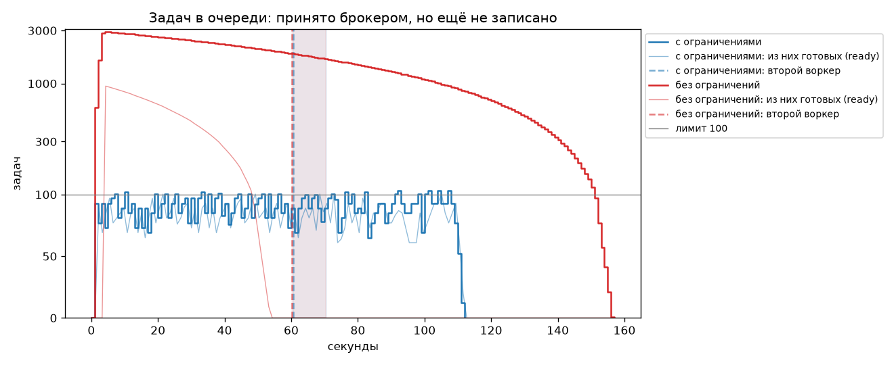
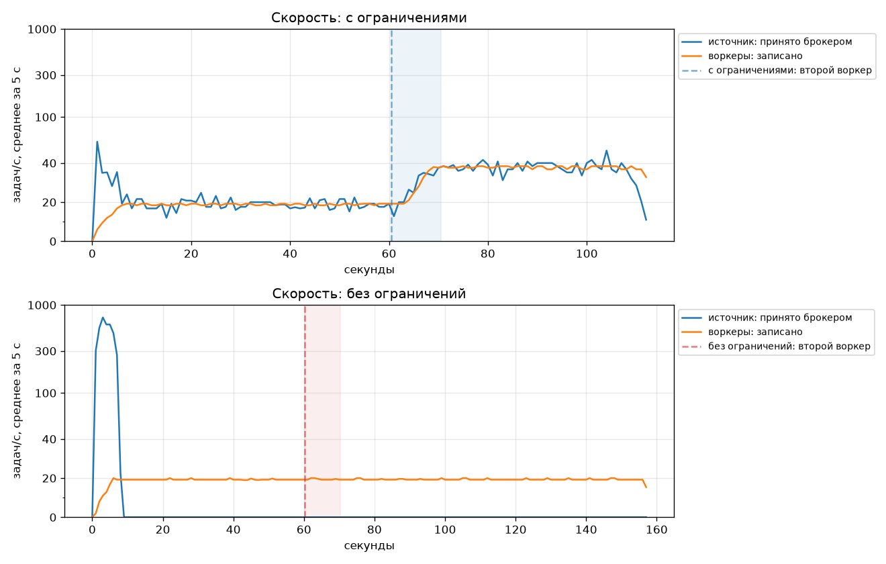
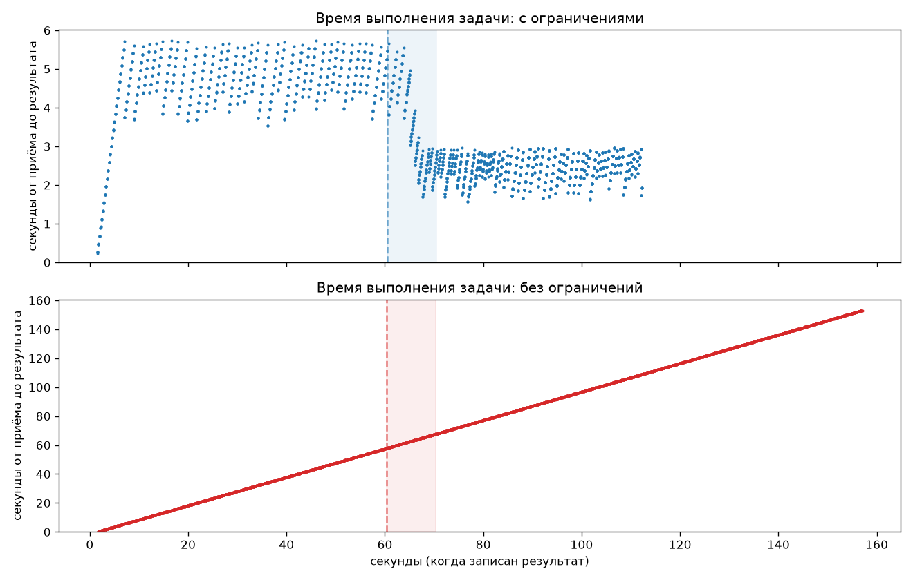
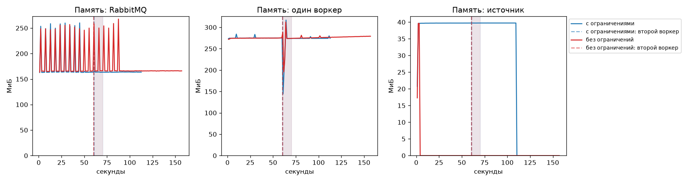

# MLOps Phishing Detector

Сервис обнаружения фишинговых сайтов по URL (датасет PhiUSIIL, UCI).
API на FastAPI принимает задачи и кладёт их в ограниченную очередь RabbitMQ,
воркер на FastStream считает их моделью из MLflow Model Registry
(`phishing-url-clf@champion`, загружается один раз при старте воркера) и пишет
результат в Postgres. Подробнее — в разделах [Конвейер задач](#конвейер-задач),
[Наблюдаемость](#наблюдаемость) и [MLflow](#mlflow).

## Быстрый старт

```bash
uv sync
uv run pre-commit install
cp .env.example .env

docker compose up -d --build --wait   # API, воркер, RabbitMQ, Postgres, MLflow (mlflow-db, s3)
curl localhost:8000/api/v1/health
```

Воркеру нужна `phishing-url-clf@champion` в реестре: без неё он падает при
старте, и `--wait` его не дождётся. Сначала модель (раздел [MLflow](#mlflow)),
или стек без воркера: `docker compose up -d --build --wait app` — API принимает
задачи, они ждут в очереди.

Без Docker: `docker compose up -d postgres rabbitmq rabbitmq-init`, затем
`uv run uvicorn mlops_phishing.app:app --reload` и воркер
`uv run faststream run mlops_phishing.worker:app` (адреса Postgres `:5433`,
RabbitMQ `:5672` и MLflow `:5050` — в `.env.example`).

## Эндпоинты

| Метод | Путь | Назначение |
|---|---|---|
| GET | `/healthz` | liveness-проба: процесс жив. Не версионируется и не ходит в БД |
| GET | `/api/v1/version` | версия из метаданных пакета, git-коммит и время сборки образа |
| GET | `/api/v1/health` | версии и `latency_ms` Postgres и RabbitMQ; 200 или 503 |
| POST | `/api/v1/tasks` | `{"url"}` → 202, `task_id` и ссылка на результат в `Location`; 503 и `Retry-After`, если очередь полна; 503 без него, если брокер не ответил за `PUBLISH_TIMEOUT` (2 с) |
| GET | `/api/v1/tasks/{task_id}` | статус `PENDING` или `DONE` и результат: вероятность фишинга, версия модели; 404, если задачи нет или она ещё не записана |

## Конвейер задач

```
источник CSV ──────┐
                   ├─ publish + confirm ─▶ [tasks] quorum-очередь: лимит 100, reject-publish
POST /api/v1/tasks ┘     nack, если полна       │ prefetch 4 = 4 потока inference
                                                ▼
       Postgres ◀── upsert по task_id ── worker (FastStream, модель @champion)
                                                │ 3 неудачные доставки
                                                ▼
                                       tasks.dlx → [tasks.dlq]
```

| Сервис | Что делает |
|---|---|
| `rabbitmq` | брокер; Management UI http://localhost:15672 (`app` / `app`) |
| `rabbitmq-init` | при каждом `up` задаёт очередь `tasks`, policy с лимитом и повторами, DLQ |
| `worker` | модель по alias, inference в пуле потоков, результат в базу; второй — `docker compose up -d --scale worker=2` |
| `source` | пакетный скоринг CSV, запускается вручную: `docker compose run --rm source --limit 2000` |

Когда очередь полна, брокер отвечает издателю nack, и дальше по-разному:

- **источник** внутри контура: ждёт с растущей паузой и шлёт ту же задачу
  снова. Буфера нет, скорость сама равна пропускной способности воркеров —
  это противодавление;
- **внешний клиент** вне контура, замедлить его нельзя: API сразу отвечает 503
  с `Retry-After` и ничего не пишет в базу — это сброс нагрузки (load shedding).
  `Retry-After` — время, за которое один воркер разберёт 20% лимита: после
  отказа quorum-очередь снова принимает с 80% лимита. При настройках по
  умолчанию 20 задач / 20 задач/с = 1 с.

Статуса `FAILED` нет: задача, ушедшая в DLQ, остаётся `PENDING`, её разбирает
оператор. Если база была недоступна в момент приёма, задача всё равно в
очереди, а строку создаст воркер — до этого GET отвечает 404.

```bash
curl -si -X POST localhost:8000/api/v1/tasks -H 'Content-Type: application/json' \
  -d '{"url": "https://secure-login-paypal.example.com/verify/account"}'
# HTTP/1.1 202 Accepted
# location: http://localhost:8000/api/v1/tasks/c0aec273-9ba5-422f-8302-e14d12d4bfb1

curl -s localhost:8000/api/v1/tasks/c0aec273-9ba5-422f-8302-e14d12d4bfb1
```

```json
{"task_id":"c0aec273-9ba5-422f-8302-e14d12d4bfb1",
 "url":"https://secure-login-paypal.example.com/verify/account","source":"api",
 "status":"DONE","is_phishing":true,"phishing_probability":0.9977993369102478,
 "model_version":"1","enqueued_at":"2026-10-20T16:35:55.193645Z",
 "completed_at":"2026-10-20T16:35:55.429423Z"}
```

## Эксперимент: с ограничениями и без

Одна и та же партия из CSV проходит конвейер в двух режимах. Нагрузка
одинаковая: 4 потока по 0.2 с на воркер, то есть 20 задач/с. Через 60 с
подключается второй воркер (`--scale worker=2`), код и настройки не меняются.

| Режим | Очередь | prefetch | Что ожидаем |
|---|---|---|---|
| `limited` | лимит 100, `reject-publish` | 4 = пул | глубина ≤ 101, источник идёт со скоростью воркеров |
| `unlimited` | без лимита (`TASKS_QUEUE_MAX_LENGTH=0`) | без лимита (`WORKER_PREFETCH=0`) | источник сразу кладёт всё, очередь и время задачи растут |

```bash
uv sync --all-groups                         # для графиков нужен matplotlib из группы ml
uv run python -m experiments.run limited     # ~2 мин: 3000 задач, второй воркер на 60-й секунде
uv run python -m experiments.run unlimited
uv run python -m experiments.plot            # графики и summary.md в experiments/results
```

`experiments.run` поднимает стек в нужном режиме, очищает очередь, запускает
источник и второй воркер, а в конце возвращает обычный режим. Параметры:
`--tasks`, `--second-worker-at`, `--max-seconds`.

Откуда метрики (`experiments/results/<режим>/`):

| Метрика | Источник | Файл |
|---|---|---|
| задач в очереди всего (готовые + у воркеров) | принятые брокером минус записанные: точно, шаг 1 с | `tasks.csv` |
| из них готовых (ready), потребители | passive declare по AMQP раз в секунду: отвечает сама очередь, без задержки | `samples.csv` |
| у воркеров (unacked), память очереди | Management API: счётчики quorum-очереди обновляются раз в 5 с (тик очереди) | `samples.csv` |
| память RabbitMQ, воркеров, источника | Docker stats контейнеров, как в `docker stats` | `samples.csv` |
| скорость источника | сколько задач брокер **принял** за секунду — по `enqueued_at` в базе. Счётчик publish у RabbitMQ считает и отвергнутые публикации | `tasks.csv` |
| пропускная способность | сколько результатов записано за секунду — по `completed_at` | `tasks.csv` |
| время выполнения задачи | `completed_at − enqueued_at`: от приёма брокером до записи результата | `tasks.csv` |

Прогон заканчивается, когда в базе записаны все задачи, принятые брокером:
это точнее, чем «очередь пуста» по статистике с шагом 5 с. Сводная таблица
по фазам (1 воркер / 2 воркера, без переходных секунд) — в
`experiments/results/summary.md`.

Время задачи считается от приёма брокером. С ограничениями строки ждут своей
очереди в CSV источника и в паузах после nack, а не в очереди брокера, поэтому
время задачи ограничено: (в очереди + у воркеров) / пропускная способность.
Длительность всей партии видна отдельно — строка «партия обработана за».

### Результаты эталонного прогона

3000 задач, второй воркер на 60-й секунде. Пунктир на графиках — запуск
второго воркера, тень — его разгон (10 с), он в таблицу не входит.






| Показатель | limited | unlimited |
|---|---|---|
| прогон завершён | да | да |
| задач | 3000 | 3000 |
| отказов брокера | 453 | 0 |
| партия обработана за, с | 112.3 | 157.1 |
| источник работал, с | 109.1 | 2.7 |
| источник в среднем, задач/с | 27.5 | 1113.6 |
| макс. задач в очереди (готовые + у воркеров) | 109 | 2936 |
| макс. готовых (ready) | 101.0 | 948.0 |
| макс. у воркеров (unacked) | 8.0 | 2000.0 |
| память источника, макс., МиБ | 39.7 | 39.6 |
| 1 воркер: источник, задач/с | 19.3 | — |
| 1 воркер: обработано, задач/с | 18.8 | 19.3 |
| 1 воркер: время задачи, среднее, с | 4.77 | 30.71 |
| 1 воркер: время задачи, p95, с | 5.5 | 55.1 |
| 1 воркер: память RabbitMQ, медиана, МиБ | 163.7 | 165.6 |
| 1 воркер: память одного воркера, макс., МиБ | 284.2 | 275.4 |
| 1 воркер: память очереди, макс., КиБ | 120 | 727 |
| 2 воркера: источник, задач/с | 37.0 | — |
| 2 воркера: обработано, задач/с | 37.9 | 19.3 |
| 2 воркера: время задачи, среднее, с | 2.43 | 110.21 |
| 2 воркера: время задачи, p95, с | 2.88 | 148.7 |
| 2 воркера: память RabbitMQ, медиана, МиБ | 163.6 | 166.1 |
| 2 воркера: память одного воркера, макс., МиБ | 280.0 | 281.4 |
| 2 воркера: память очереди, макс., КиБ | 108 | 727 |

### Выводы

- **Глубина очереди держится у лимита.** С ограничениями в системе максимум 109
  задач (`depth.png`): до 101 готовой и до 8 у двух воркеров. 101 — это лимит 100
  плюс одно сообщение, так работает quorum-очередь: после 101-го она отвечает
  nack. Без ограничений в системе максимум 2936 задач. Это не сумма пиков: готовых
  было до 948 (на 4.3 с), неподтверждённых у воркера до 2000 (на 8.6 с) — в разные моменты.
- **Источник идёт в темпе воркеров, и настраивать его не нужно.** С одним
  воркером источник принимал 19.3 задач/с при обработке 18.8 (`rates.png`),
  со вторым 37.0 против 37.9. Частоты в конфиге нет: источник ждёт ack
  брокера, а после nack делает паузу и шлёт ту же задачу. Из 109.1 с работы он
  провёл в паузах 104.3 с (453 отказа). Без ограничений nack нет: источник
  выгрузил все 3000 задач за 2.7 с (1113.6 задач/с).
- **Второй воркер ускоряет конвейер только при заданном prefetch.** С
  `prefetch_count` 4 и без правки кода пропускная способность выросла с 18.8
  до 37.9 задач/с, источник вслед за ней с 19.3 до 37.0. Без ограничений
  prefetch не задан, и первый воркер забрал в работу 2000 сообщений (потолок
  quorum-очереди, `unacked` на `depth.png`). Второму не досталось ничего,
  обработка осталась 19.3 задач/с. Причина не в безлимитной очереди, а в
  prefetch больше реальной конкурентности (пул из 4 потоков): лишние сообщения
  лежат у воркера неподтверждёнными, а при его падении все 2000 пришлось бы
  доставлять заново.
- **Время задачи ограничено и падает со вторым воркером.** С ограничениями
  среднее 4.77 с и p95 5.5 с с одним воркером, 2.43 и 2.88 с с двумя
  (`latency.png`). Это закон Литтла: в системе в среднем около 90 задач
  (принято минус записано, по `tasks.csv`) при 18.8 задач/с дают 90 / 18.8 ≈
  4.8 с, с двумя воркерами около 88 / 37.9 ≈ 2.3 с. Верхняя граница с одним
  воркером (101 + 4) / 20 + 0.2 ≈ 5.5 с совпадает с p95. Без ограничений
  каждая задача ждёт все предыдущие: среднее 30.71 с, p95 55.1 с с одним
  воркером и 110.21 с, p95 148.7 с с двумя. Второй воркер здесь не помогает:
  источник выгрузил всю партию за ~3 с, а первый воркер сразу забрал 2000
  неподтверждённых (prefetch не задан), так что второму почти нечего брать —
  на 60-й секунде в системе всё ещё 1877 задач.
- **Ограничения не замедляют обработку партии.** Все 3000 задач обработаны за
  112.3 с против 157.1 с без ограничений: выигрыш даёт ровно распределение
  работы между воркерами (prefetch равен пулу), а не размер очереди.
- **Память почти не зависит от режима, и это честный результат.** RabbitMQ
  занимает 163.7 МиБ против 165.6 МиБ, воркер около 280 МиБ, источник около 40
  МиБ в обоих режимах. Сообщения маленькие: 3000 по ~200 Б меньше 1 МБ, и брокер
  без них занимает те же 165 МиБ. Выросла только память самой очереди, со 120
  до 727 КиБ, в 6 раз. С крупными сообщениями или долгим бэклогом без лимита
  росла бы и память брокера, а источник в обоих режимах держит в памяти одну
  неподтверждённую задачу. Пики RabbitMQ до 260–270 МиБ на `memory.png` есть в
  обоих режимах, поэтому сравниваются медианы.
- **Задачи не теряются, а перегрузка не ведёт к зависанию клиента.** В обоих
  режимах `published` = `done` = 3000 (`run.json`). Эксперимент не измеряет DLQ
  и 503, их проверяют интеграционные тесты на настоящем RabbitMQ
  (`tests/integration/test_rabbit_backpressure.py`): переполнение и открытие
  очереди на 80% лимита, ожидание источника без потерь, 503 без PENDING в базе,
  DLQ после лимита доставок и для битого сообщения, graceful shutdown. Живая
  проверка: источник работает, воркер остановлен, 50 запросов `POST
  /api/v1/tasks` — все 503 с `Retry-After: 1`, самый медленный ответ 25 мс,
  записей PENDING 0 → 0.

## Проверки

```bash
uv run ruff check . && uv run ruff format --check .
uv run pytest                 # тесты + покрытие, порог 80%
uv run pytest -m integration --no-cov  # только Postgres и RabbitMQ, без порога покрытия
uv run pre-commit run --all-files
```

Модульные тесты обработчиков идут на `TestRabbitBroker`: брокер в памяти
проверяет логику ack и reject, но лимита очереди, nack издателю и DLQ не знает.
Это проверяют интеграционные тесты в `tests/integration/`: Testcontainers
поднимает те же образы, что в compose (RabbitMQ — с лимитом 10 через тот же
`rabbit_setup`), и тесты проверяют:

- переполнение: quorum-очередь принимает лимит + 1 сообщение (11), 12-я
  публикация сразу получает nack, приём снова начинается при 80% лимита;
- API: при полной очереди 503 с `Retry-After`, PENDING только у принятых задач;
- источник: в три раза больше лимита, медленный потребитель — всё доставлено
  ровно один раз и по порядку, глубина не выше лимита + 1;
- воркер: 1 + delivery-limit доставок и DLQ, битое сообщение в DLQ с первой
  доставки, prefetch ограничивает задачи в работе, остановка дописывает взятые,
  а дошедшие сверх них по prefetch возвращаются в очередь необработанными;
- публикация в несуществующую очередь — ошибка, а не потеря.

Без Docker локально эти тесты пропускаются, в CI (job `test`) — падают.

При остановке FastStream сначала дописывает задачи в работе и только потом
отменяет подписку, поэтому брокер успевает дослать до prefetch новых задач.
Они возвращаются в очередь при закрытии канала, и RabbitMQ 4.3 может засчитать
такой возврат попыткой: delivery-limit 3 оставлен с запасом на перезапуски.

## Docker

Двухстадийный образ: в builder `uv` ставит сначала зависимости (слой
кэшируется), потом сам пакет (non-editable, с `METADATA`, откуда читается
версия). В runtime попадает только `.venv`, без `uv` и исходников.
Процесс работает под непривилегированным пользователем, `HEALTHCHECK` бьёт
в `/healthz`. `GIT_COMMIT` и `BUILD_TIME` передаются build-аргументами и
отдаются в `/api/v1/version`.

## CI/CD

### CI — `.github/workflows/ci.yml`

Запускается на push в любую ветку и на pull request в `main`.

| Job | Что делает |
|---|---|
| `lint` | `uv lock --check`, `ruff check`, `ruff format --check`, все хуки pre-commit |
| `test` | pytest с покрытием (падает ниже 80%) |
| `smoke` | поднимает MLflow, регистрирует игрушечную seed-модель как `@champion`, `docker compose up --wait` (API, RabbitMQ, воркер), запросы к эндпоинтам и задача через `POST /api/v1/tasks`, которая доходит до `DONE` с версией модели 1 |

### CD — `.github/workflows/cd.yml`

Собирает образ и публикует в GHCR: `ghcr.io/vovamujik/mlops_phishing`.

**Условие запуска:** push git-тега `vX.Y.Z`, и только после того, как для
этого коммита заново прошёл весь CI (CI подключён как reusable workflow,
`needs: ci`).

Обоснование:

- **Релиз это осознанное решение.** Не каждый коммит в `main` должен
  становиться образом. Тег ставится, когда версия готова, реестр не
  засоряется промежуточными сборками.
- **В реестр не попадает непроверенный код.** Публикация зависит от
  линтеров, тестов и smoke-теста с БД.
- **Одна версия везде.** CD падает, если тег не совпадает с `version` в
  `pyproject.toml`. Эта же версия приходит в `/api/v1/version` из метаданных
  пакета. В итоге git-тег, тег образа и ответ API всегда совпадают.
- **Неизменяемость и откат.** Семвер-тег не перезаписывается, откат это
  деплой предыдущего тега.

**Версионирование образа** для тега `v1.2.3`:

| Тег образа | Смысл |
|---|---|
| `1.2.3` | точная неизменяемая версия |
| `1.2` | последний патч минорной ветки |
| `sha-<7 символов>` | трассировка до коммита |
| `latest` | последний релиз |

### Выпуск релиза

```bash
uv version --bump patch          # или вручную поправить version в pyproject.toml
git commit -am "chore: release $(uv version --short)"
git tag "v$(uv version --short)"
git push && git push --tags
```

## Наблюдаемость

Конвейер наблюдаем по трём сигналам: по логам, трейсам и метрикам видно и
систему целиком (очередь у лимита, скорость источника, DLQ), и любую задачу
(где она, сколько ждала в очереди, сколько считалась). Сервисы приложения
не знают о хранилищах: логи пишут в stdout, трейсы и метрики отправляют по
OTLP в Collector.

```
 api ─┐  stdout JSON ──────────▶ Alloy ──▶ Loki ─────────┐
 worker ┤                                                 │
 source ┘  OTLP/HTTP ──▶ OTel Collector ─┬─▶ Tempo ───────┼──▶ Grafana
                     (memory_limiter → batch)              │   (дашборд, алерты,
 rabbitmq :15692 ◀── scrape ── Prometheus ◀── OTLP ───────┘    лог ↔ трейс ↔ метрика)
```

### Запуск

```bash
docker compose up -d                          # только приложение, логи в stdout
docker compose --profile logs up -d           # + Alloy и Loki
docker compose --profile traces up -d         # + Collector и Tempo
docker compose --profile metrics up -d        # + Collector и Prometheus
docker compose --profile observability up -d  # всё, включая Grafana
```

Grafana: http://localhost:3000 (анонимный просмотр, `admin`/`admin` — пароль
стенда из `.env.example`), дашборд «Конвейер» открывается домашним.
Prometheus для PromQL: http://localhost:9090.

Стек описан в [`observability/compose.yaml`](observability/compose.yaml), он
подключается из `docker-compose.yml` через `include`, и у каждого его сервиса
есть `profiles`. `depends_on` приложения на него не ссылается: без Collector
SDK копит спаны в ограниченной очереди (2048, лишнее отбрасывает) и шлёт их из
фонового потока, ответы API не замедляются (проверено: 202 за ~7 мс с
остановленным Collector), ошибка экспорта пишется в лог не чаще раза в минуту.
`OTEL_SDK_DISABLED=true` выключает SDK совсем.

`docker compose --profile observability stop` без списка сервисов
останавливает и приложение. Только наблюдаемость:
`docker compose stop alloy loki otel-collector tempo prometheus grafana`.

### Почему Loki, Tempo и Prometheus

- Это нативные datasource Grafana: переходы лог → трейс (derived field),
  трейс → логи (`tracesToLogsV2`) и график → трейс (exemplars) работают без
  плагинов, и Grafana поднимается с нуля без доступа в интернет.
- Loki индексирует только лейблы, а не текст: на стенде с тремя лейблами
  индекс крошечный, поиск по `task_id` — фильтр по нескольким потокам.
  Elasticsearch индексирует каждое поле и требует heap от гигабайта; VictoriaLogs
  ищет по полям дешевле, но в Grafana нужен её плагин.
- Весь профиль `observability` укладывается в 1,44 ГиБ лимитов (таблица ниже).

### Логи

Одна JSON-строка на запись, единый набор полей у api, worker, source и у
библиотек (uvicorn, faststream, aio_pika, asyncpg, mlflow):

```json
{"timestamp": "2026-11-11T10:19:09.655Z", "level": "info", "service": "worker", "env": "development",
 "logger": "mlops_phishing.worker", "message": "Задача обработана", "task_id": "22592702-…",
 "attempt": 1, "model_version": "1", "is_phishing": true,
 "trace_id": "482e068c260dbbf07832b66d453696f5", "span_id": "3515dba1e8d6098e"}
```

- **structlog поверх stdlib.** `ProcessorFormatter` прогоняет через одну
  цепочку и наши записи, и чужие, поэтому логи библиотек в том же формате.
  Контекст задачи — встроенный `merge_contextvars`. python-json-logger — только
  форматтер: контекст, trace_id и маскирование паролей пришлось бы дописывать.
  Подробнее — docstring [`logging_config.py`](src/mlops_phishing/logging_config.py).
- **task_id едет через RabbitMQ** в `correlation_id` (и `message_id`).
  Middleware воркера кладёт его и номер попытки в contextvars на время
  сообщения, поэтому он есть в каждой записи обработчика, а руками его никто
  не дописывает. API добавляет `request_id`, источник — `row`.
- **trace_id и span_id** процессор берёт из текущего спана OpenTelemetry.
- **Секреты:** пароль в любом URL (DSN Postgres, AMQP) маскируется во всех
  полях, включая стектрейс. URL из CSV в лог не пишется.
- **Уровень** — `LOG_LEVEL`. Успешные health-check (`/healthz`,
  `/api/v1/health`) пишутся на DEBUG.

| Событие | Уровень | Поля |
|---|---|---|
| модель загружена | INFO | `model_alias`, `model_version`, `model_run_id` |
| брокер отказал, источник замедлился | INFO (первый отказ серии), DEBUG (остальные) | `attempt`, `delay` |
| скорость источника раз в 5 с | INFO | задач/с, отказов за 5 с |
| ответ 503 | WARNING | `retry_after`, `task_id` |
| ошибка записи результата, задача вернётся в очередь | WARNING + стектрейс | `attempt` |
| перевод в DLQ | ERROR (+ стектрейс у битого сообщения) | `attempt`, `delivery_limit` |
| начало и конец graceful shutdown | INFO | `in_flight`, итоговые счётчики |

**Лейблы Loki — только `service`, `level`, `env`.** Каждая комбинация
лейблов — отдельный поток со своим индексом и чанками. `task_id` дал бы поток
на каждую задачу: после файла в 6000 строк — 6000 потоков по одной-две строки,
индекс раздувается, а запрос «ошибки за 15 минут» перебирает их все. Поэтому
`task_id` и `trace_id` лежат в structured metadata записи
([`alloy/config.alloy`](observability/alloy/config.alloy)): поиск
`{service=~".+"} | task_id="…"` сначала сужает до трёх потоков, потом
фильтрует строки.

### Трейсы

Одна задача — один трейс через все процессы (снято с живого стенда):

```
api     POST /api/v1/tasks              4.6 ms
api       default.tasks create
api         default.tasks publish       2.0 ms   ← traceparent в заголовках сообщения
api       INSERT (PENDING)              0.6 ms
worker  default.tasks process         209.8 ms   ← +5128 ms: столько задача ждала в очереди
worker    inference                   206.5 ms   (model.alias, model.version)
worker    db.save_result                1.7 ms
worker      INSERT                      0.8 ms
```

- SDK OpenTelemetry, экспорт OTLP/HTTP в Collector (`memory_limiter` первым:
  он отказывает приёму до того, как батч займёт память; затем `batch`).
  `service.name` = api / worker / source, `service.version`,
  `deployment.environment.name` — из `OTEL_*`, `service.instance.id` —
  hostname контейнера, поэтому две реплики воркера различимы.
- Через RabbitMQ контекст несёт `RabbitTelemetryMiddleware` FastStream: W3C
  `traceparent` в заголовках, process воркера продолжает трейс издателя.
- `run_in_executor` не копирует contextvars, поэтому inference запускается
  через `contextvars.copy_context().run`: спан `inference` — дочерний к
  process, а не корневой.
- Источник: каждая строка — свой корневой трейс `source.task`, отказы брокера
  — события `broker.rejected` и дочерние спаны `source.backoff` с номером
  попытки и паузой. Один трейс на пачку дал бы тысячи спанов в одном трейсе.
- Ошибки: статус ERROR и `record_exception`, номер попытки в
  `messaging.rabbitmq.delivery_count`, перевод в DLQ — атрибут
  `messaging.rabbitmq.dead_lettered` и событие `dead_lettered`. Все попытки
  ядовитого сообщения — в одном трейсе (общий родитель publish). Ответ 503 —
  трейс со статусом ERROR и записанным `DeliveryError`.
- Поиск в Tempo: `{span.task.id="<task_id>"}`, ошибки — `{status=error}`.

**Семплер.** Стенд: `OTEL_TRACES_SAMPLER=parentbased_traceidratio` с
аргументом 1.0 — сохраняется каждый трейс, чтобы найти любой task_id. Прод при
сотнях задач в секунду: тот же семплер с долей 0.01–0.1 (решение принимает
начало трейса — API или источник, воркер наследует его через traceparent,
трейсы не рвутся) плюс tail sampling в Collector — все трейсы с ошибкой и
медленнее SLO, остальное по доле. Один head-семплинг терял бы большую часть
ошибок, один tail — гнал бы весь поток спанов через Collector.

### Метрики

| Метрика (в Prometheus) | Тип | Лейблы |
|---|---|---|
| `http_server_request_duration_seconds` | histogram | `http_request_method`, `http_route`, `http_response_status_code` |
| `tasks_queue_limit` | gauge | — |
| `source_tasks_published_total` | counter | — |
| `source_broker_rejections_total` | counter | — |
| `source_backoff_duration_seconds_total` | counter (сумма пауз) | — |
| `worker_tasks_processed_total` | counter | `result` = ok / error / dlq |
| `worker_inference_duration_seconds` | histogram | — |
| `worker_task_duration_seconds` | histogram (от постановки до записи, для SLO) | — |
| `worker_tasks_in_flight` | gauge | — |
| `worker_redeliveries_total` | counter | — |
| `process_memory_usage_bytes` | gauge (system-metrics) | — |
| `rabbitmq_detailed_queue_messages{,_ready,_unacked}` | gauge (плагин RabbitMQ) | `queue` |

У всех метрик приложения `job` = service.name, `instance` = service.instance.id.

- **Бакеты** подобраны под конфиг, а не по умолчанию: inference — доли от
  `INFERENCE_DELAY_SECONDS` (при 0.2 с: 0.05, 0.1, 0.15, 0.2, 0.205, 0.21,
  0.22, 0.23, 0.25, 0.3, 0.4, 0.6, 1, 2), API — 0.005…5 с с границами у
  таймаута публикации 2 с, задача целиком — 0.25…120 с.
- **Push для приложения, pull для RabbitMQ.** Источник — пакетный процесс на
  минуты: pull-скрейп раз в 5 с мог бы его не застать, а итог партии потерялся
  бы при выходе; push по OTLP отправляет остаток в `shutdown`. Реплики
  воркера (`--scale worker=2`) не нужно регистрировать в Prometheus. Глубину
  очередей приложение не считает: Prometheus скрейпит встроенный плагин
  `rabbitmq:15692/metrics/detailed` (per-queue).
- **Оценка рядов** (стенд: api, 2 воркера, источник) — произведение значений лейблов:

| Метрика | Расчёт | Рядов |
|---|---|---|
| HTTP-гистограмма | ~8 комбинаций метод × маршрут × код × (12 бакетов + sum + count) | ~112 |
| inference | 2 воркера × (15 бакетов + 2) | 34 |
| задача целиком | 2 × (14 + 2) | 32 |
| processed | 2 × 3 результата | 6 |
| in_flight, redeliveries | 2 × 2 | 4 |
| источник, лимит | 3 + 1 | 4 |
| память, CPU, target_info | 4 + 8 + 4 | 16 |
| **итого** | | **~210** |

  Лейбл `task_id` после файла в 6000 строк: одна гистограмма inference дала
  бы 6000 × 17 ≈ 102 тыс. рядов, каждый счётчик — ещё 6000, и все они живут
  в head Prometheus, пока не уйдут из retention.

PromQL выводов прошлой работы (на стенде с одним, затем двумя воркерами):

```promql
sum(rate(source_tasks_published_total[20s]))                     # скорость источника
sum(rate(worker_tasks_processed_total{job="worker"}[20s]))       # пропускная способность воркеров
sum by (instance)(rate(worker_tasks_processed_total[20s]))       # по воркерам
histogram_quantile(0.95, sum by (le)(rate(worker_inference_duration_seconds_bucket[1m])))
```

Прогон 3000 задач: со вторым воркером источник 35.7 задач/с при 18.5 + 18.6
у воркеров, p95 inference 0.212 с.

### Grafana

Всё настроено файлами: datasources, дашборд и алерты в
[`observability/grafana/`](observability/grafana/) поднимаются после
`docker compose down -v` и `up` без единого клика.

Дашборд «Конвейер» ([`pipeline.json`](observability/grafana/dashboards/pipeline.json)):
глубина `tasks` и `tasks.dlq` с линией лимита `tasks_queue_limit`, скорость
источника против суммарной пропускной способности воркеров на одном графике и
разбивка по воркерам, p50/p95/p99 inference, ответа API и задачи целиком
(с exemplars → трейс), память процессов, доля 503, отказы брокера, рост DLQ,
задачи в работе, последние ошибки из Loki и трейсы с ошибками из Tempo.
Переменные — сервис и экземпляр воркера; у всех панелей единицы, у счётчиков
`rate`.

Корреляция: из записи Loki кнопка `trace_id` открывает трейс в Tempo, из
спана — «Logs for this span» показывает логи всего трейса, с графика латентности
exemplar ведёт к трейсу.

| Алерт | Условие | `for` | Почему так |
|---|---|---|---|
| Очередь заполнена > 90% | `max_over_time(ready{queue="tasks"}[30s]) / tasks_queue_limit > 0.9` | 1m | При reject-publish глубина пилит между 80% (там очередь снова принимает) и лимитом. Мгновенное значение проваливалось ниже 90% и сбрасывало `for` — алерт не доходил до Firing. Максимум за 30 с отвечает «упиралась ли очередь в лимит»; минута отсекает нормальный всплеск пачки |
| В DLQ появились сообщения | `delta(messages{queue="tasks.dlq"}[5m]) > 0` | 30s | Любое сообщение в DLQ — задача после всех попыток, нужен человек. Не «глубина > 0»: старые сообщения держали бы алерт вечно и скрыли новые. 30 с — защита от артефакта одного скрейпа |
| SLO: быстрое сжигание бюджета | burn rate > 14.4 и за 5 мин, и за 1 мин | 1m | Multiwindow из SRE workbook: длинное окно подтверждает, что это не всплеск, короткое — что проблема ещё идёт (алерт гаснет сразу после починки). В проде окна 1 ч и 5 мин, стенд живёт минуты — окна уменьшены в 12 раз. 14.4 — 2% месячного бюджета за час. Алерт на симптом (задачи медленные), а не на причину |
| Prometheus не видит RabbitMQ | `up{job="rabbitmq"} < 1` | 1m | Без него алерты на очередь и DLQ при потере скрейпа молча уходят в NoData → OK. Минута — перезапуск брокера (10–20 с) не будит |

### SLO и error budget

SLO стенда: **99% задач — от постановки в очередь до записи результата — быстрее
10 с** (`worker_task_duration_seconds`, у гистограммы есть граница `le="10"`).
С одним воркером и лимитом очереди 100 задача ждёт около 5 с, запас двукратный.

```promql
# SLI: доля задач быстрее 10 с
sum(rate(worker_task_duration_seconds_bucket{job="worker", le="10"}[5m]))
  / sum(rate(worker_task_duration_seconds_count{job="worker"}[5m]))
# остаток бюджета за окно: 1 − доля медленных / 1%
1 - (1 - sum(increase(…_bucket{le="10"}[1h])) / sum(increase(…_count[1h]))) / 0.01
# burn rate: во сколько раз быстрее нормы тратится бюджет
(1 - SLI) / 0.01
```

Бюджет ошибок — 1% задач за окно, их можно «потратить» на медленные задачи без
нарушения SLO. Burn rate 1 — бюджет кончится ровно к концу окна, 14.4 — 30-дневный
бюджет уходит за 2 дня. На дашборде — ряд «SLO»: SLI с линией 99%, остаток бюджета
за 1 ч (окно стенда; в проде — 30 дней) и burn rate за 1 и 5 минут.

Проверка на стенде: `INFERENCE_DELAY_SECONDS=0.5 docker compose up -d worker`, затем
источник. Очередь у лимита держит задачу около 100 × 0.5 / 4 = 12.5 с — дольше SLO;
алерт быстрого сжигания ушёл в Firing с burn rate 92 (5 мин) и 100 (1 мин).

### Бюджет памяти

| Сервис | `mem_limit` | `docker stats` под нагрузкой |
|---|---|---|
| alloy | 160 MiB | 76 MiB |
| loki | 256 MiB | 110 MiB |
| otel-collector | 160 MiB | 87 MiB |
| tempo | 256 MiB | 175 MiB |
| prometheus | 256 MiB | 50 MiB |
| grafana | 384 MiB | 269 MiB |
| **итого** | **1472 MiB (1,44 ГиБ)** | **767 MiB** |

Замер — прогон 4000 задач источником и поток `POST /api/v1/tasks` на полной
очереди. Retention: Loki, Tempo и Prometheus — 2 суток. Образы закреплены по
версиям (`.env.example`), данные — в именованных томах, у хранилищ и Grafana
есть healthcheck. У Loki, Tempo и Collector в образах нет shell, поэтому их
healthcheck — статический busybox из одноразового сервиса `hc-tools`.

### Сценарии защиты

Скрипты в [`demo/`](demo/) создают ситуацию и печатают, где искать её след:

```bash
uv run python -m demo.poison              # битое сообщение в tasks → DLQ с первой попытки, алерт DLQ
uv run python -m demo.flood --requests 300  # поток POST при полной очереди: коды, Retry-After, request_id 503
uv run python -m demo.series --rows 6000  # ряды метрик сейчас и с лейблом task_id
```

На стенде (очередь у лимита): `flood` — 105 ответов 202 и 195 ответов 503 с
`Retry-After: 1` за 0.6 с, по `request_id` отказа в Loki находится запись с
`trace_id`; `series` — 102 ряда сейчас, с `task_id` после 6000 строк добавится
≈ 318 тыс. (гистограмма inference — 6000 × 17 = 102 тыс.). Повторы до
delivery-limit и DLQ показывает остановленный Postgres: `docker compose stop
postgres`, затем задача через API.

### Ограничения

- `docker compose down -v` стирает и реестр MLflow: перед воркером нужна
  модель, на стенде — `uv run --group ml python -m training.seed_ci_model`
  после `docker compose up -d --wait mlflow`.
- Имя проекта `mlops-phishing` зашито в фильтр Alloy: с `-p другое-имя` логи
  собираться не будут.
- Метрики источника приходят с новым `instance` на каждый запуск, на
  дашборде он агрегируется по `job`. После перезапуска воркера старые ряды
  ещё до 5 минут видны в разбивке по экземплярам.

## MLflow

### Сервисы и порты

```
Комп: training/*.py ── http://localhost:5050 ──┐
                                               ▼
worker ──────── http://mlflow:5000 ──▶ mlflow (сервер + UI)
                                        ├─▶ mlflow-db (Postgres): эксперименты, раны, метрики, реестр
                                        └─▶ s3 (RustFS, бакет mlflow): графики и модели
```

| Сервис | Адрес с компа | Назначение |
|---|---|---|
| `mlflow` | http://localhost:5050 | Tracking Server и UI. 5000 на macOS занят AirPlay |
| `mlflow-db` | — | Postgres, Backend Store: эксперименты, раны, метрики, реестр |
| `s3` | http://localhost:9001 | RustFS, Artifact Store; веб-консоль `mlflow` / `mlflow-secret` |
| `s3-init` | — | создаёт бакет `mlflow` и завершается с кодом 0 |
| `worker` | — | FastStream: загружает модель при старте, считает задачи из очереди |
| `app` | http://localhost:8000 | FastAPI: `POST /api/v1/tasks`, `GET /api/v1/tasks/{task_id}` |
| `postgres` | `localhost:5433` | Postgres приложения |

Клиенты знают только адрес MLflow: файлы проксирует сервер, ключи от S3
только у него.

### От запуска до предсказания

```bash
uv sync --all-groups                          # обычный `uv sync` удалит группу ml
docker compose up -d --wait mlflow            # только MLflow (+ mlflow-db, s3): воркеру пока нечего загружать
uv run python -m training.download_data       # CSV в data/raw/ + проверка sha256

uv run python -m training.eda                 # ран в эксперименте phiusiil-eda
uv run python -m training.train baseline normalized handcrafted host-only

# run_id берётся из UI или из вывода train
uv run python -m training.registry register <run_id baseline>    # v1
uv run python -m training.registry register <run_id normalized>  # v2
uv run python -m training.registry alias champion 2
uv run python -m training.registry show

docker compose up -d --build --wait           # воркер стартует, когда @champion уже есть
curl -s -X POST localhost:8000/api/v1/tasks -H 'Content-Type: application/json' \
  -d '{"url": "https://secure-login-paypal.example.com/verify/account"}'
curl -s localhost:8000/api/v1/tasks/<task_id из ответа>
```

Воркер при старте один раз разрешает `phishing-url-clf@champion` в номер версии
и загружает её. Если он уже запущен (например, после быстрого старта), после
`alias` нужен `docker compose restart worker`: без рестарта модель не
перечитывается. Результат задачи содержит `model_version` — версию, которая его
посчитала (пример ответа — в разделе [Конвейер задач](#конвейер-задач)).

Переключение версии без правки кода: `registry alias champion 1` и
`docker compose restart worker` (без пересборки) — в логе старта
`Воркер готов: модель phishing-url-clf v1 (@champion)`, новые задачи получают
`"model_version":"1"`. `registry alias champion 2` и ещё один рестарт
возвращают v2. Версия меняется только при старте воркера.

Модели `normalized`, `handcrafted` и `host-only` ссылаются на функции из
`src/mlops_phishing/features.py`. Со старым образом без этого файла загрузка
упадёт с `ModuleNotFoundError`: воркер не стартует, причина в логе, задачи
ждут в очереди.

### EDA

Эксперимент `phiusiil-eda`, ран `eda`: 8 графиков,
таблица ROC-AUC каждого числового признака, выводы `conclusions.md`.
Датасет: 235 795 URL, 134 850 легитимных и 100 945 фишинга (42.8%),
константная модель даёт accuracy 0.572. В датасете много подсказок,
выдающих метку:

| Подсказка | Что видно |
|---|---|
| `URLSimilarityIndex` | `== 100` у 100% легитимных и 0.8% фишинга; правило «≠ 100 → фишинг» даёт accuracy 99.67% |
| Префикс `https://www.` | у 100% легитимных и 2.4% фишинга |
| `/` после хоста | у 0% легитимных и 60% фишинга: легитимные URL — только главные страницы |
| `FILENAME` | имя файла выдаёт источник, а значит и метку: accuracy 100% |
| HTML-признаки | 9 из топ-10 по одиночному AUC (`LineOfCode` 0.990, `NoOfExternalRef` 0.988): медиана у фишинга около 0, страницу просто не удалось скачать |
| Дубли | 425 повторов URL; в обучении убираются, сплит по доменам |

Поэтому точность около 1.0 здесь — сигнал утечки, а не качества. Сервис
принимает только сырой URL: HTML-признаки и `URLSimilarityIndex` в момент
запроса недоступны, `FILENAME` — артефакт сборки датасета.

### Варианты

Эксперимент `phishing-url-clf`, один вариант — один ран. Сплит по доменам
70/15/15, основная метрика `val_pr_auc` (PR-AUC по фишингу), test — финальная
проверка.

| Вариант | Модель |
|---|---|
| `baseline` | TF-IDF по символьным 3–5-граммам сырого URL → LogisticRegression |
| `normalized` | то же, но из URL убраны схема, `www.` и `/` в конце |
| `handcrafted` | 12 своих признаков нормализованного URL (длина, доли символов, поддомены, IP, `xn--`, login/verify/account, бесплатные хостинги) → HistGradientBoosting |
| `host-only` | как `normalized`, но TF-IDF только по хосту, без пути и query |

Раны в UI называются по варианту. Метрики детерминированы: сплит и модели
с фиксированным seed, повторный запуск даёт те же числа. Время зависит от машины.

| Вариант | val PR-AUC | test PR-AUC | val recall | test recall | val FPR | test FPR | train, с | predict, мс/1000 URL |
|---|---|---|---|---|---|---|---|---|
| `baseline` | 0.9989 | 0.9992 | 0.9902 | 0.9923 | 0.0000 | 0.0000 | 5.1 | 20.9 |
| `normalized` | **0.9543** | 0.9472 | 0.8128 | 0.7946 | 0.0260 | 0.0239 | 7.3 | 16.7 |
| `handcrafted` | 0.8946 | 0.8790 | 0.6830 | 0.6529 | 0.0269 | 0.0287 | 4.3 | 6.4 |
| `host-only` | 0.9371 | 0.9279 | 0.7697 | 0.7457 | 0.0393 | 0.0363 | 4.3 | 15.0 |

Проверка на отдельных URL, вероятность фишинга:

| URL | baseline | normalized | handcrafted | host-only |
|---|---|---|---|---|
| `https://www.google.com` | 0.001 | 0.713 | 0.230 | 0.911 |
| `https://github.com/mlflow/mlflow` | 0.990 | 0.963 | 1.000 | 0.747 |
| `https://github.com` | 0.696 | 0.588 | 0.230 | 0.747 |
| `https://www.wikipedia.org` | 0.002 | 0.029 | 0.208 | 0.030 |
| `https://www.microsoft.com` | 0.009 | 0.576 | 0.208 | 0.570 |
| `https://docs.python.org/3/library/os.html` | 0.976 | 0.924 | 1.000 | 0.364 |
| `http://paypal-verify-account.web.app` | 1.000 | 0.998 | 1.000 | 0.999 |
| `https://secure-login-paypal.example.com/verify/account` | 0.998 | 0.998 | 1.000 | 0.928 |

### Выводы

- **v2 = `normalized`.** Критерий заявлен заранее: лучший `val_pr_auc` среди
  вариантов без прямой подсказки схемы и `www.`. У `normalized` 0.954 против
  0.937 у `host-only` и 0.895 у `handcrafted`.
- **Но перевес над `host-only` целиком даёт путь.** В val нет ни одного
  легитимного URL с путём, и правило «есть путь → фишинг» даёт precision 1.000
  при recall 0.334. На URL без пути (все 20 260 легитимных и 10 733 фишинговых
  в val) варианты равны: PR-AUC 0.909 у обоих, на test тоже. `normalized`
  оставили v2: на URL без пути он не хуже, а путь в реальном трафике несёт
  настоящие признаки фишинга (`/login`, `/verify`). В этом датасете путь —
  ещё и утечка, см. ограничения.
- **`baseline` в отбор не идёт** и остаётся v1 для истории. Его 0.999 держится
  на префиксе `https://www.`, найденном в EDA: google он считает легитимным
  только потому, что URL начинается с `https://www.`.
- **Переобучения нет.** У всех вариантов val и test расходятся не больше чем
  на 0.016 по PR-AUC и 0.031 по recall; сплит по доменам не даёт модели узнать
  в test сайт из train.

### Ограничения

- **Ни один вариант не годится для реального использования.** Легитимный класс
  в датасете — только главные страницы вида `https://www.<домен>` без путей и
  почти без крупных брендов. Любая страница с путём выглядит для модели как
  фишинг, а хост с брендом — тоже: `google` встречается в 1 388 фишинговых
  URL и в 12 легитимных, `github` — в 402 и в 1.
  `normalized` (v2) называет `https://www.google.com` фишингом с p=0.71.
- **Каждый шаг убирает одну подсказку датасета и обнажает следующую.**
  `normalized` снимает схему и `www.`, но остаётся путь. `host-only` снимает
  путь, но модель начинает считать фишингом бренды. Метрики падают на каждом
  шаге: это не регрессия, а честная оценка того, что URL сам по себе знает о
  фишинге в этом датасете.
- **Горячее обновление по alias.** Переключить `@champion` и
  `docker compose restart worker`: пока воркер стартует, обработка стоит, а API
  продолжает принимать задачи — они ждут в очереди (до лимита, дальше 503 с
  `Retry-After`); воркеры, перезапущенные в разное время, пишут разные
  `model_version`; новая версия может требовать новый код (`features.py`), то
  есть модель и образ связаны.
